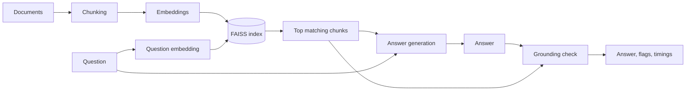

# RAG Pipeline with Automated Output Validation

A question-answering system that reads your documents, answers questions using only what they contain, and then checks whether each sentence of the answer is actually supported by those documents.


---

## Overview

This project is a **Retrieval-Augmented Generation (RAG)** pipeline built from scratch in Python. RAG means that, instead of letting a language model answer from memory alone, the system first looks up the most relevant parts of your documents and hands them to the model as reference material.

On top of that, this project adds an **automated validation step**. After an answer is generated, each sentence is compared against the retrieved material. Sentences that don't appear to be backed by it are flagged, and the time taken by each stage is recorded.

## Why this project exists

Language models write fluent, confident text, even when the content is not supported by any source. In a document question-answering setting, this is a real risk: a reader may assume an answer came from the documents when the model actually filled in a gap on its own.

Retrieval reduces this problem, but it does not remove it. A model can still ignore the supplied material or add details beyond it. This project tries to make that visible by checking the answer after it is written, so that questionable statements can be spotted instead of silently trusted.

## Features

- **Document chunking:** long documents are split into smaller sections with a small overlap, so related information is not cut apart at the edges.
- **Local embeddings:** text is converted into numerical representations using a sentence-transformers model that runs on your own machine, so building the index needs no API key.
- **Fast similarity search with FAISS:** the most relevant sections for a question are found quickly using a vector index.
- **Context-restricted answers:** the language model is instructed to answer only from the retrieved sections, and to say so when the answer is not there.
- **Sentence-level grounding check:** every sentence of the answer is scored against the retrieved sections, and low-scoring sentences are flagged as unsupported.
- **Latency tracking:** retrieval, generation and validation are timed separately.
- **Swappable language model:** the generation step lives in one file, so the model provider can be changed easily.

## How it works



1. **Chunking.** Each document is split into pieces of roughly 500 characters, breaking at paragraph, line or sentence boundaries where possible. A small overlap is kept between neighbouring pieces.
2. **Embedding.** Each piece is converted into a vector (a list of 384 numbers) that represents its meaning. Pieces with similar meaning end up with similar vectors, which allows search by meaning instead of exact words.
3. **Indexing.** The vectors are stored in a FAISS index, which is built for fast nearest-neighbour search.
4. **Retrieval.** The question is converted into a vector using the same model, and the closest pieces are fetched from the index (4 by default).
5. **Generation.** The question and the retrieved pieces are sent to a language model with instructions to answer only from that material.
6. **Validation.** The answer is split into sentences. Each sentence is embedded and compared with the retrieved pieces using cosine similarity. A sentence whose best match falls below a threshold (0.55 by default) is flagged as unsupported.
7. **Reporting.** The result includes the answer, the sources used, the flagged sentences, a grounded-sentence ratio and the time taken by each stage.

## Tech stack

| Purpose | Tool |
|---|---|
| Language | Python |
| Embeddings | sentence-transformers (`all-MiniLM-L6-v2`) |
| Vector search | FAISS (`IndexFlatIP` on normalised vectors) |
| Answer generation | Anthropic API (can be replaced) |
| Validation | Cosine-similarity grounding check |

## Project structure

```
.
├── config.py          # Settings: chunk size, overlap, top-k, threshold, model names
├── chunking.py        # Loads documents and splits them into chunks
├── embed_index.py     # Creates embeddings and builds the FAISS index
├── retrieval.py       # Finds the chunks most relevant to a question
├── generate.py        # Builds the prompt and calls the language model
├── validation.py      # Grounding check and latency timer
├── main.py            # Command-line entry point
├── requirements.txt   # Python dependencies
└── sample_docs/       # Example document to try the pipeline
```

## Installation and usage

**Requirements:** Python 3.10 or newer, and an API key for the language model provider.

```bash
git clone https://github.com/mansiigopale/RAG_Project.git
cd RAG_Project

python3 -m venv venv
source venv/bin/activate          # Windows: venv\Scripts\activate
pip install -r requirements.txt

export ANTHROPIC_API_KEY=your_key_here
```

The first run downloads the embedding model (about 80 MB) once.

**Step 1: build the index from your documents**

```bash
python main.py index
```

**Step 2: ask a question**

```bash
python main.py query "What is a common failure mode in RAG systems?"
```

To use your own documents, place `.txt` files in `sample_docs/` (or change `DOCS_DIR` in `config.py`) and run the index step again.

## Configuration

All settings are in `config.py`.

| Setting | Default | What it controls |
|---|---|---|
| `CHUNK_SIZE` | 500 | Approximate characters per chunk |
| `CHUNK_OVERLAP` | 50 | Characters shared between neighbouring chunks |
| `TOP_K` | 4 | Number of chunks retrieved per question |
| `GROUNDING_THRESHOLD` | 0.55 | Minimum similarity for a sentence to count as supported |
| `EMBED_MODEL_NAME` | all-MiniLM-L6-v2 | Embedding model |
| `LLM_MODEL` | see `config.py` | Language model used for answers |

The grounding threshold is a starting value, not a proven one. It should be adjusted by testing on your own documents: a higher value flags more sentences, a lower value flags fewer.

## Limitations

- **Similarity is not proof.** The grounding check measures how close a sentence is to the source in meaning. It does not verify that the sentence is true or that it agrees with the source. A sentence on the same topic that changes a detail (a number, a date, a negation) can still score well and pass.
- **Paraphrases can be flagged unfairly.** A correct sentence that is worded very differently from the source may score low and be marked unsupported.
- **The threshold is not calibrated.** The default has not been tuned against a labelled set of good and bad answers, so results should be read as a signal, not a verdict.
- **Retrieval quality limits everything.** If the right section is not retrieved, the answer and the check both suffer.
- **Plain text only.** Only `.txt` files are supported at the moment.
- **Scale.** The index performs an exact search over all vectors. This is fine for small and medium collections, but would become slow for very large ones.

## Future work

- Replace the similarity check with a natural language inference (NLI) model that judges whether a source supports, contradicts or is unrelated to a sentence.
- Build a small labelled evaluation set to tune the threshold and report measured accuracy.
- Add PDF and Word document loaders.
- Use an approximate index (such as IVF or HNSW) for larger collections.
- Log grounding scores and latency over time to catch regressions.
- Add a simple web interface.

## Author

**Manasi Gopale**
M.Tech Data Science, NIT Jalandhar
[GitHub](https://github.com/mansiigopale) · [LinkedIn](https://linkedin.com/in/mansi-gopale-0926732ba/)